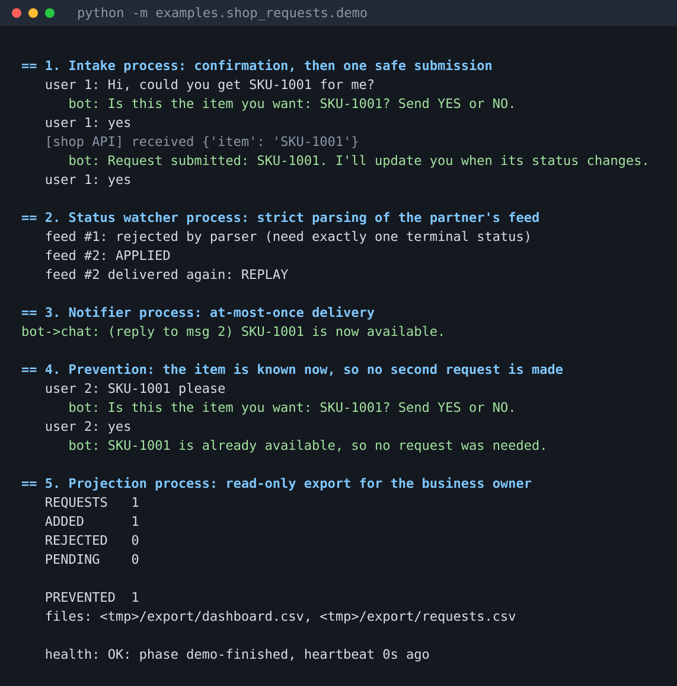

# bot-kit

Small, dependency-free building blocks for **reliable request-handling bots**
(support desks, order intake, community request queues, partner-API relays).
Pure Python standard library, SQLite as the single source of truth, 35 offline tests.

> Written from scratch around a neutral "shop request" example. It contains no
> third-party client code, names, data or credentials. The ideas are standard
> reliability patterns (idempotency keys, transactional outbox, fail-closed parsing).

## See it run

`python -m examples.shop_requests.demo` runs the whole system with fake I/O:
a confirmed request, a double YES that does nothing, a vague status message the parser
refuses, a replayed message that is ignored, and a read-only export for the business owner.



## Why it exists

Chat bots that talk to the outside world fail in boring, expensive ways:
a restart sends the same order twice, a retry double-charges, a replayed message
spams the customer, a spreadsheet edit silently changes bot state. Each module
here closes one of those holes and is covered by tests that simulate the failure.

## Architecture

```
 customer chat ──► INTAKE ──────────────┐             ┌──► partner / form / API
 (any transport)   confirm → admit →    │  SQLite     │
                   claim → submit ──────┼──(WAL)──────┤
 partner status ─► WATCHER              │             │
 feed (any source) parse → apply ───────┤             └──► business owner
                                        │
                   NOTIFIER ◄───────────┤  outbox      PROJECTION (read-only → CSV / Sheets)
                   drain, at-most-once  │
                   HEALTH heartbeat ◄───┘
```

Four independent, supervised processes share only the database file, so a crash
or slow API in one cannot block the others.

| Module | Guarantee |
|---|---|
| `dispatch` | Intent is committed **before** the outside call. Ambiguous failures become `OUTCOME_UNKNOWN` and are **never** auto-retried; a crash mid-call is treated the same way. |
| `confirm` | YES/NO tied to chat + user, with expiry. A declined or expired confirmation cannot be revived by a later "YES". |
| `policy` | Pending cap, rolling rate limit, strikes with admin waive / fresh cycle. Evidence is never deleted. |
| `requests` | Idempotency, policy, catalog check and insert happen in one transaction. Items already known to exist are *prevented* (counted, never struck). |
| `feed` | Parser rejects anything ambiguous. Applying an event, its ledger row, state change, strike and notification commit atomically. Replays are harmless; terminal states are never overwritten. |
| `outbox` | Claim (`DISPATCHING`) is committed before sending. A failed send becomes `DELIVERY_UNKNOWN` for an operator, so nobody gets the same message twice. |
| `projection` | Read-only connection, full refresh, atomic file replace. Exports can never feed back into bot state. |
| `health` | Heartbeat file; missing, corrupt or old state is reported as UNKNOWN/STALE, never as OK. |
| `intake` | Transport-agnostic conversation: text in, replies out. A chat adapter is ~20 lines. |

## Try it

```bash
python -m examples.shop_requests.demo          # whole flow, fake I/O, prints a transcript
python -m unittest discover -s tests -t .      # 35 tests, no network
```

## Start a new bot from the parts

```bash
python new_bot.py acme-support --modules intake,feed,outbox,projection,health
cd acme-support && python -m unittest discover -s tests -t .
```

The generator copies only the chosen modules (and their dependencies) plus matching
tests, `.gitignore`, `.env.example` and a README. The generated repo is self-contained
and its tests pass on their own.

## Plugging in a real chat or API

* **Chat**: call `Intake.handle(chat_id, user_id, msg_id, text)` from your
  python-telegram-bot / Discord / web handler and send the returned strings.
* **Outside system**: implement `submit(payload)` that returns on confirmed
  acceptance, raises `DefinitelyNotSent` if it provably never left, anything
  else means "uncertain".
* **Sender**: pass `drain(conn, send)` a function that raises on failure.
* **Production**: `deploy/bot-kit@.service` is a systemd template, one unit per worker.

## Design rules

1. Write the intent first, call the outside world second.
2. If you cannot prove an outcome, record "unknown" and let a human decide. Do not retry.
3. Parse strictly and fail closed.
4. One transaction per business event.
5. Exports are read-only projections, never inputs.
6. Secrets and session files stay out of Git.
